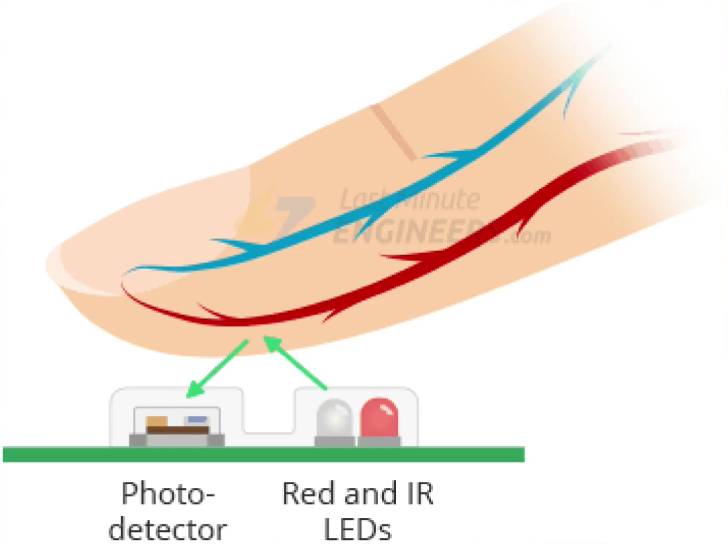

# DOC_MAX30102 
# Teste Preliminar e Comparativo de Sensor de SpO2/BPM

## 1. Objetivo do teste

Validar de forma **isolada** o sensor MAX30102 (frequência cardíaca e saturação de oxigênio) antes da integração com o restante do sistema. O teste cobre três frentes:

1. Detecção do sensor no barramento I2C (hardware/fiação ok).
2. Leitura bruta de sinal (IR/RED) e confirmação de detecção de contato.
3. Cálculo comparativo de BPM e SpO2 usando **dois algoritmos diferentes**, sobre o mesmo buffer de amostras, para análise de concordância.

**Status:**
- Sensor detectado e lendo de forma consistente. 
- Os dois algoritmos de cálculo (padrão e alternativo) foram executados com sucesso sobre os mesmos dados.

---

## 2. Como o sensor funciona

O MAX30102 é um sensor de oximetria de pulso (fotopletismografia, PPG). Ele combina dois LEDs (vermelho e infravermelho) com um fotodetector, montados lado a lado no módulo:

*Fonte da ilustração: Last Minute Engineers. [Link](https://lastminuteengineers.com/max30102-pulse-oximeter-heart-rate-sensor-arduino-tutorial/)*

**Princípio físico:** os LEDs emitem luz vermelha e infravermelha através do tecido (geralmente a ponta do dedo). O sangue arterial absorve essas duas luzes em proporções diferentes dependendo da saturação de oxigênio, sangue oxigenado absorve mais luz infravermelha e deixa passar mais luz vermelha; sangue desoxigenado faz o inverso. O fotodetector, posicionado ao lado dos LEDs (não atravessando o dedo, mas captando a luz refletida/retroespalhada pelo tecido), mede a intensidade de luz que retorna.

A cada batimento cardíaco, o volume de sangue arterial no dedo pulsa, causando uma variação periódica na quantidade de luz absorvida. Esse sinal pulsante é o que permite calcular:
- **BPM (batimentos por minuto):** a partir da periodicidade do sinal (distância entre picos sucessivos).
- **SpO2 (saturação de oxigênio):** a partir da razão entre as componentes pulsáteis (AC) dos canais vermelho e infravermelho.

---

## 3. Por que dois algoritmos foram testados

### 3.1 Algoritmo padrão (Maxim/SparkFun)

É o algoritmo de referência, originado do reference design da Maxim Integrated e distribuído pela biblioteca `SparkFun MAX3010x Pulse and Proximity Sensor Library`. Funciona com janela fixa de 100 amostras, faz detecção de picos no canal IR para estimar BPM, e usa razão IR/RED com tabela de lookup para estimar SpO2.

### 3.2 Algoritmo alternativo (`algorithm_by_RF`)
[Link do repositório](https://github.com/aromring/MAX30102_by_RF/)

Reimplementação de terceiros que adiciona uma camada de filtro de qualidade baseada em dois indicadores estatísticos calculados sobre o próprio sinal:
- **Autocorrelação:** mede o quão periódico/repetitivo é o sinal pois os sinais de pulso reais são altamente periódicos; artefatos de movimento tendem a quebrar essa periodicidade.
- **Correlação de Pearson** entre os canais IR e RED: mede o quão bem as duas componentes pulsáteis se correlacionam, o que é esperado fisiologicamente.

Apenas quando ambos os indicadores superam limiares configuráveis (`min_autocorrelation_ratio`, `min_pearson_correlation`) o algoritmo aceita a leitura como válida.

### 3.3 Justificativa para o teste comparativo

A literatura aponta limitações conhecidas do algoritmo padrão: pequenos movimentos do dedo já causam picos grandes no sinal (artefato de movimento), por isso é recomendado fazer média de múltiplas amostras e verificar a flag de validade que o próprio algoritmo calcula. Entretanto, essa flag de validade do algoritmo padrão é permissiva, ou seja, ela não incorpora verificação de periodicidade nem de correlação entre canais, podendo classificar como "válida" uma leitura que é, na prática, artefato.

O algoritmo alternativo foi proposto e documentado em um Instructable como melhoria de precisão sobre o algoritmo padrão da Maxim, justamente por incorporar esse filtro de qualidade adicional.

---

## 4. O que o firmware de teste faz

Arquivo: `main.cpp` (ambiente `max_teste_comparativo`, sem WiFi/MQTT/DS18B20/LEDs).

1. Inicializa I2C nos pinos 21 (SDA) e 22 (SCL) e detecta o MAX30102.
2. Coleta uma janela de 100 amostras (IR + RED) do FIFO do sensor.
3. Executa **os dois algoritmos sobre o mesmo buffer**:
   - `maxim_heart_rate_and_oxygen_saturation()` (padrão).
   - `rf_heart_rate_and_oxygen_saturation()` (alternativo, com filtro de qualidade), que adicionalmente devolve a razão IR/RED usada no cálculo e a correlação de Pearson.
4. Imprime as duas saídas lado a lado, junto com as respectivas flags de validade. Veja mais do log no PR #6

**Detalhe técnico de integração:** as duas bibliotecas definem internamente uma macro `BUFFER_SIZE` com significados diferentes, o que gerava conflito de compilação. A correção aplicada foi um `#undef BUFFER_SIZE` entre os dois `#include`, e o uso de um nome próprio (`MEU_BUFFER_SIZE`) no código de teste.

---

## 5. Resultado do teste comparativo

Após um período inicial de instabilização do sinal (esperado — equivalente à fase de "aquecimento" observada no teste do DS18B20), os dois algoritmos passaram a convergir para valores fisiologicamente plausíveis:

| Métrica | Algoritmo Padrão (Maxim/SparkFun) | Algoritmo Alternativo (RF) |
|---|---|---|
| Taxa de leituras aceitas como válidas | 100% (41/41 janelas) | ~78% (32/41 janelas) |
| BPM em regime estável | ~71–100 bpm | ~71–88 bpm |
| SpO2 em regime estável | ~99–100% | ~99,0–99,7% |
| Rejeita artefatos de movimento? | Não — sempre retorna um valor | Sim — usa autocorrelação + correlação de Pearson |

**Achado mais relevante:** em pelo menos dois instantes do teste, o algoritmo padrão retornou valores clinicamente implausíveis com flag de "válido":
- SpO2 = 64% (validado=1) — valor compatível com hipóxia grave, quase certamente artefato de movimento/ajuste do dedo durante a transição inicial.
- BPM = 166 (validado=1) — valor compatível com taquicardia significativa em repouso, também atípico para o contexto do teste.

Em ambos os casos, o algoritmo alternativo, processando a mesma janela de dados, **rejeitou** a leitura (retornou -999, validado=0), com a autocorrelação ainda alta (0,991 e 0,993 respectivamente) mas a razão IR/RED (`ratio`) fora da faixa de confiança fisiológica, evidenciando assim que o filtro de qualidade adicional captura inconsistências que a flag de validade padrão não captura.

---

## 6. Discussão e implicação para o projeto

Os dois algoritmos concordam bem quando o sinal está estável (diferença típica de BPM entre 0–10 bpm; SpO2 praticamente equivalente). A diferença relevante está no comportamento frente a artefatos:

- O **algoritmo padrão** prioriza disponibilidade: sempre entrega um número, mesmo quando esse número é fisiologicamente implausível, sem sinalizar baixa confiança de forma confiável.
- O **algoritmo alternativo** prioriza especificidade: sacrifica ~1 em cada 5 janelas (rejeitadas), mas reduz o risco de propagar um falso alarme clínico (ex: um SpO2 de 64% incorreto sendo registrado como leitura válida) para as camadas seguintes do sistema.

Em um sistema de telemedicina, um falso alarme de hipóxia ou taquicardia tem custo real (alerta desnecessário, perda de confiança no sistema). Por isso, a escolha entre os dois algoritmos (ou uma combinação dos dois, usando o padrão como fallback quando o RF rejeita) é uma decisão de projeto que vale ser explicitamente justificada e testada com mais dados antes da integração final.

---

## 7. Pendências e próximos passos

- [ ] Consolidar as taxas de rejeição e concordância em uma análise estatística mais robusta com o dataset MIMIC-III - Deep Reinforcement Learning.
- [ ] Testar sensibilidade dos parâmetros do filtro de qualidade (`min_autocorrelation_ratio`, `min_pearson_correlation`) do algoritmo alternativo.
- [ ] Definir, para o sistema integrado, qual algoritmo (ou estratégia de combinação dos dois) será usado como fonte de dados para o pipeline de fog computing / ML.
- [ ] Repetir o mesmo padrão de teste isolado (detecção → estabilidade → comparação) já aplicado ao DS18B20 e ao MAX30102.

---

## 8. Referências

1. Princípio de funcionamento do sensor de oximetria de pulso MAX30102 (fotopletismografia com LEDs vermelho/infravermelho e fotodetector). Last Minute Engineers. Disponível em: https://lastminuteengineers.com/
2. Repositório de referência do algoritmo padrão: biblioteca SparkFun MAX3010x Pulse and Proximity Sensor Library, derivada do reference design MAXREFDES117# da Maxim Integrated, Inc.
3. Algoritmo alternativo com filtro de qualidade baseado em autocorrelação e correlação de Pearson: aromring/MAX30102_by_RF. Disponível em: https://github.com/aromring/MAX30102_by_RF —>> descrito em detalhe no Instructable "Pulse Oximeter With Much Improved Precision": https://www.instructables.com/id/Pulse-Oximeter-With-Much-Improved-Precision/